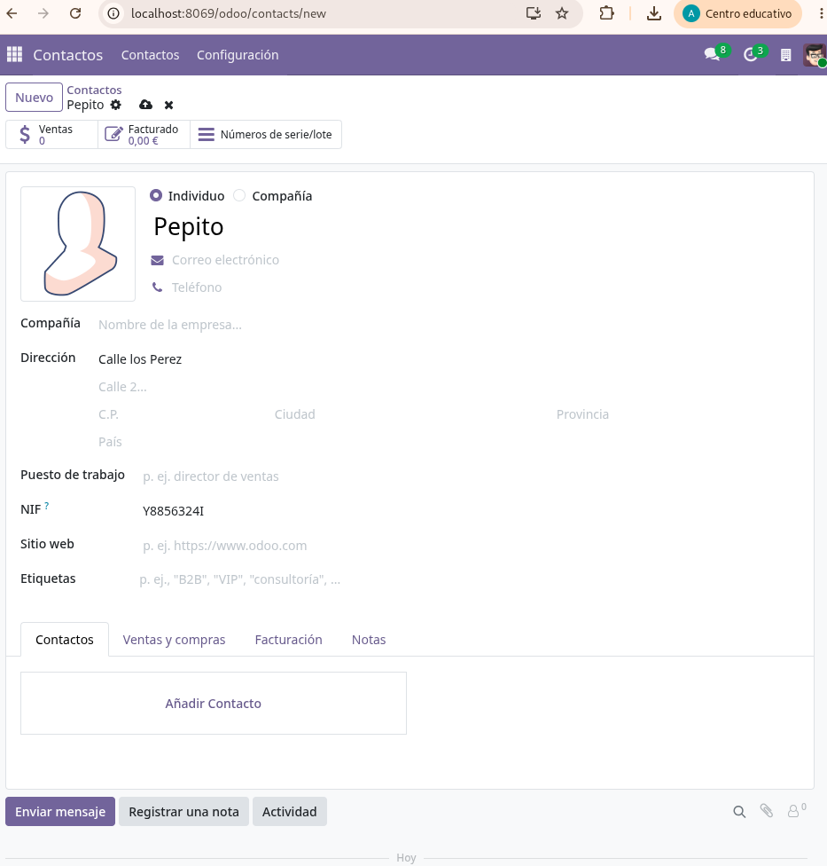
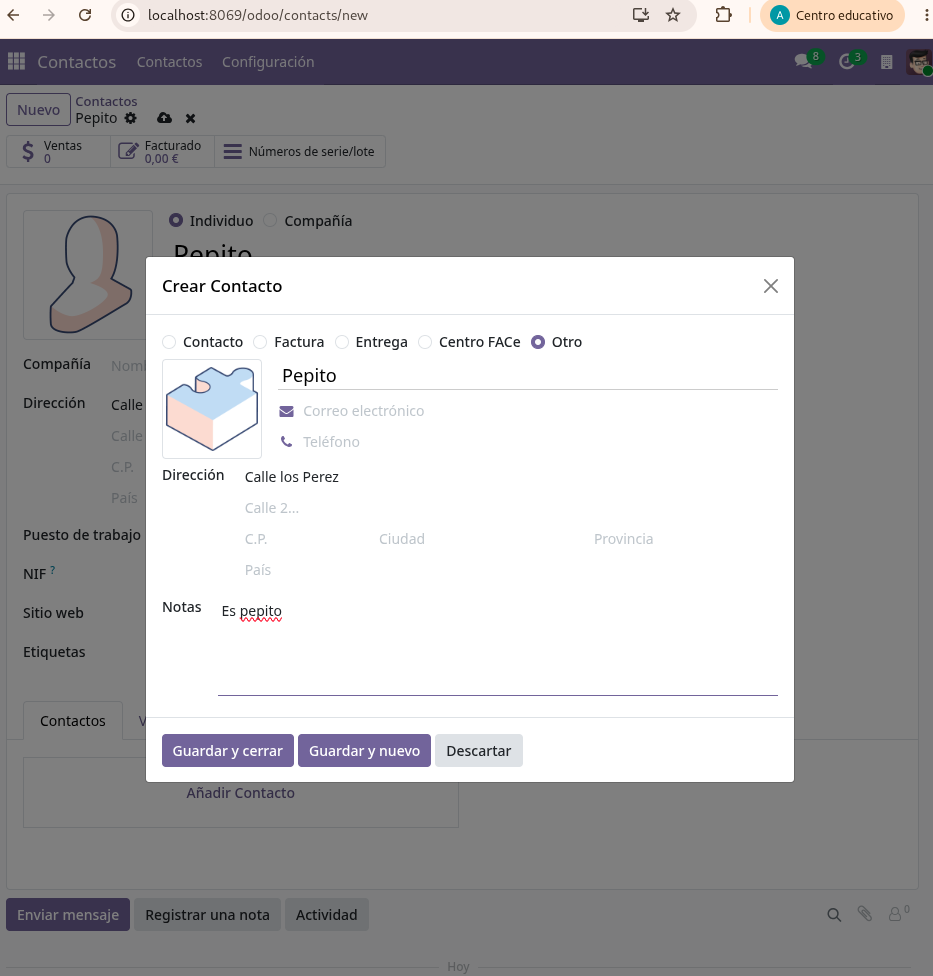
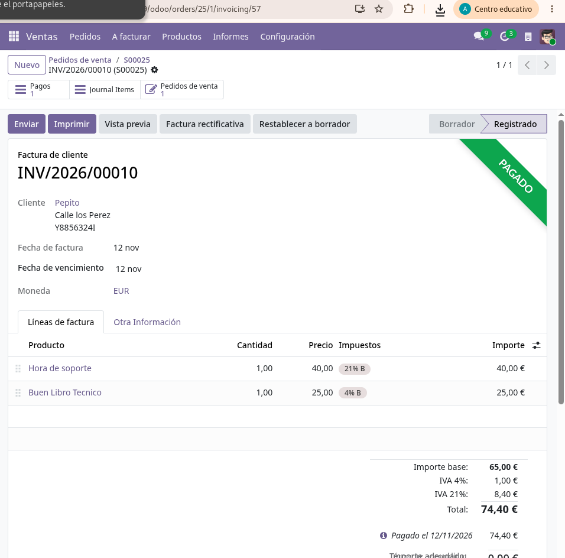
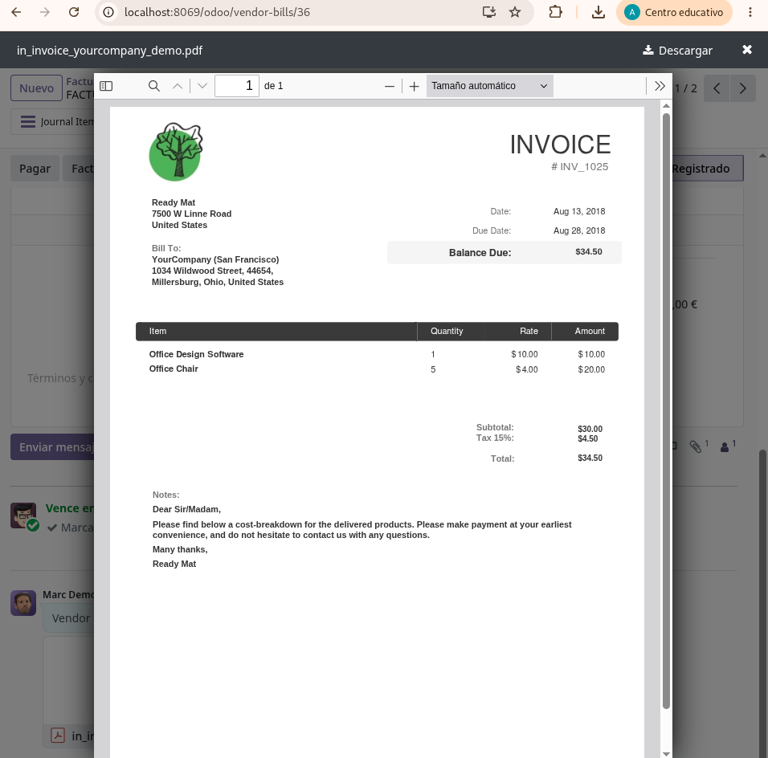

# Tarea 09 

---
## 1. Bases de Datos

Al acceder por primera vez a `http://localhost:8069`, se configuran dos bases de datos independientes en el gestor (`/web/database/manager`):

| Base de datos | Idioma | País (Localización) | Datos de demostración | Finalidad |
| :--- | :--- | :--- | :--- | :--- |
| **`demo`** | Español (`es_ES`) | España (`ES`) | **Sí** (Activados) | Entorno de pruebas y aprendizaje con clientes, productos y facturas de ejemplo. |
| **`real`** | Español (`es_ES`) | España (`ES`) | **No** (Desactivados) | Entorno limpio configurado desde cero para la empresa real de la siguiente actividad. |

---

## 2. Ejercicio 1 · Tipos de producto e impuestos

Con la aplicación **Inventario** instalada, Odoo 19 clasifica los productos en cuatro tipologías principales. Al revisar los productos precargados en la base de datos `demo`, se observa que **los artículos de demostración vienen sin impuestos asignados por defecto** (a diferencia de los productos creados manualmente, que heredan el impuesto predeterminado configurado en *Facturación → Configuración → Ajustes*):

### 2.1. Bienes con *Rastrear inventario* (Almacenable)
Producto físico del que se lleva control de existencias, entradas, salidas y stock por almacén (ej. *Escritorio en L con asiento a la izquierda*).
* **Impuestos asignados**: Vacíos en la ficha de demostración.

### 2.2. Bienes sin *Rastrear inventario* (Consumible)
Producto físico que se entrega pero del que no se gestiona inventario ni niveles de stock (ej. *Folios, tornillería*).
* **Impuestos asignados**: Vacíos en la ficha de demostración.

### 2.3. Servicio
Prestación intangible que no se entrega físicamente ni genera movimientos de almacén (ej. *Horas de soporte o instalación*).
* **Impuestos asignados**: Vacíos en la ficha de demostración.

### 2.4. Combinación (Pack)
Conjunto de varios productos agrupados que se venden de forma conjunta, gestionándose el stock de cada componente por separado.
* **Impuestos asignados**: Vacíos en la ficha de demostración.

---

## 3. Ejercicio 2 · Recorrido: del cliente a la factura pagada

### 3.1. Contactos: Compañía vs. Individuo
En el módulo **Contactos**, Odoo diferencia entre **Compañía** (entidad jurídica/empresa) e **Individuo** (persona física). Los individuos pueden vincularse dentro de la ficha de una compañía (pestaña *Contactos y direcciones*) heredando su dirección fiscal y condiciones comerciales.

### 3.2. Creación de cliente nuevo
Se da de alta un nuevo cliente de tipo *Compañía* con su razón social, dirección postal completa, NIF/CIF validado y una etiqueta de clasificación.

### 3.3. Creación de productos nuevos
Se crean dos artículos marcando la casilla **Ventas** y verificando la asignación automática de impuestos según su naturaleza:
1. **Hora de soporte**: Tipo *Servicio*, precio de venta `40,00 €`, Impuesto de venta `21% IVA`.
2. **Libro técnico**: Tipo *Bienes*, precio de venta `25,00 €`, Impuesto de venta `4% IVA`.

### 3.4. Presupuesto y confirmación a Pedido de Venta
Desde **Ventas**, se genera un presupuesto para el nuevo cliente añadiendo ambos productos. Tras simular el envío por correo electrónico y pulsar **Confirmar**, el documento cambia de estado a **Pedido de venta**.

### 3.5. Facturación, PDF y Registro de Pago
Desde el pedido de venta se genera la factura borrador (`Crear factura`). Se verifica que cada línea aplica correctamente su tipo impositivo (21% y 4%) y que la base imponible y el total cuadran. Tras confirmarla y descargar su versión en PDF, se registra el cobro, apareciendo la etiqueta verde **Pagado**.

### 3.6. Comparativa con Factura de Proveedor
Al inspeccionar una factura en **Facturación → Proveedores → Facturas**, se observan diferencias clave respecto a las de cliente: utiliza impuestos soportados (de compra) en lugar de repercutidos, incorpora un campo específico para la referencia de factura del proveedor y gestiona cuentas bancarias de destino para el pago.

### 3.7. Planificación de actividad en el Chatter
En el panel lateral (*Chatter*) de la ficha del cliente se programa una actividad de seguimiento (llamada telefónica), quedando registrada en el historial del registro.

---

## 4. Ejercicio 3 · Vistas, búsquedas y filtros

En **Facturación → Clientes → Facturas**, utilizando la **Vista lista**, se aplica el filtro predefinido **Publicadas** y se organiza mediante **Agrupar por → Cliente**. Finalmente, esta vista personalizada se almacena desde el menú **Favoritos → Guardar búsqueda actual** para su reutilización rápida.

---

## 5. Ejercicio 4 · Modo desarrollador

El modo desarrollador habilita el acceso a metadatos técnicos, modelos, vistas y dependencias (identificable por el icono del escarabajo en la barra superior).

### 5.1. Vías de activación utilizadas
1. **Desde Ajustes**: Navegando hasta el final de la página principal de *Ajustes* y pulsando en *Herramientas de desarrollador → Activar el modo desarrollador*.
   
2. **Desde la URL**: Añadiendo el parámetro `?debug=1` directamente en la barra de direcciones del navegador (`http://localhost:8069/odoo?debug=1`).
   

### 5.2. Nombres técnicos inspeccionados
Al posicionar el cursor sobre los campos con el modo desarrollador activo, se identifican los siguientes metadatos:

| Ubicación | Campo visible | Nombre técnico | Modelo asociado |
| :--- | :--- | :--- | :--- |
| Formulario de Contactos | NIF / CIF | `vat` | `res.partner` |
| Formulario de Contactos | Correo electrónico | `email` | `res.partner` |
| Formulario de Facturas | *(Documento completo)* | — | `account.move` |

---

## 6. Incidencias

Registro de incidencias y comprobaciones realizadas durante la implantación:

| Fecha | Síntoma | Causa | Solución |
| :--- | :--- | :--- | :--- |
| 12/11/2026 | Necesidad de instalar el módulo *Inventario* adicionalmente | En Odoo 19 la casilla *Rastrear inventario* dentro de *Bienes* solo se habilita si la app de Inventario está instalada. | Instalación del módulo **Inventario** desde el menú de *Aplicaciones*. |
| 12/11/2026 | Productos de demostración sin impuestos asignados | Los datos precargados de demo no incluyen impuestos por defecto en sus fichas. | Verificación manual y comprobación de que los productos nuevos sí heredan el IVA configurado en Facturación. |

---

## 7. Declaración de uso de IA

* **Herramienta utilizada**: Gemini (Asistente de IA).
* **Finalidad**: Consulta de sintaxis y buenas prácticas para la configuración de `docker-compose.yml` (uso de `healthcheck` y variables de entorno) y estructuración del formato Markdown del presente manual de implantación (`README.md`).
* **Modificaciones y verificación**: Toda la configuración de los contenedores, la creación de las bases de datos (`demo` y `real`), el recorrido funcional completo en Odoo 19, la captura de evidencias y la validación técnica de campos se realizaron y verificaron manualmente en local.